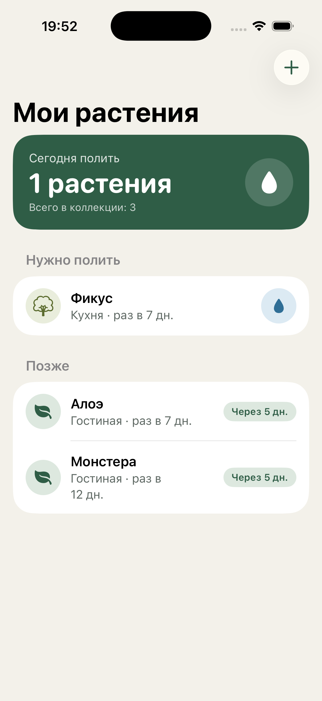
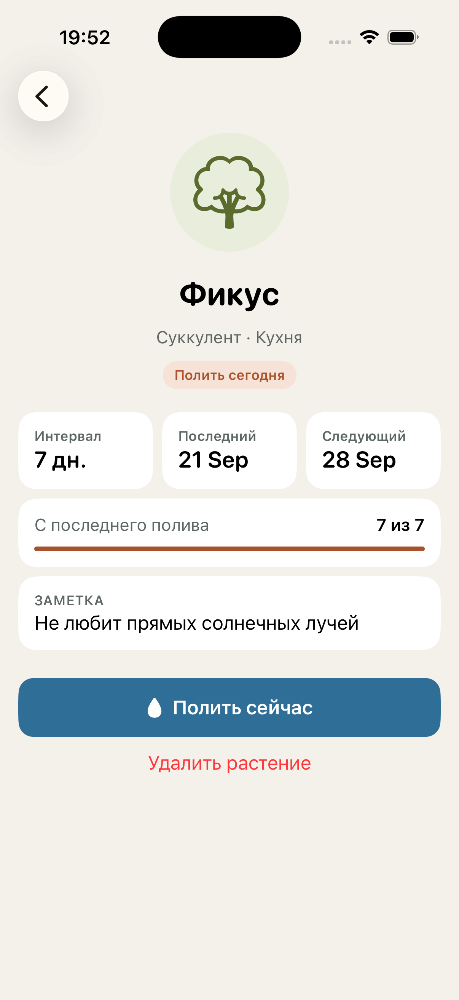
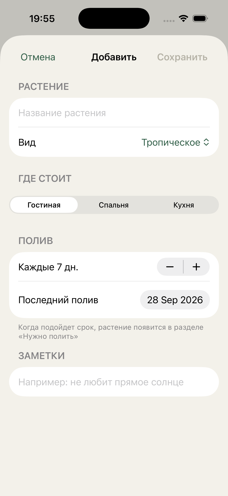

# 🌿 Листва

**Листва** — iOS-приложение для ухода за комнатными растениями. Добавьте свои растения, укажите, как часто их поливать, и Листва покажет, какие из них нужно полить сегодня.

Мой первый проект на SwiftUI: от дизайна до готового приложения.

<p align="center">
  
  
  
</p>

## Возможности

- **Сводка на сегодня** — карточка сверху показывает, сколько растений нужно полить.
- **Разделы «Нужно полить» и «Позже»** — список сам сортирует растения по дате следующего полива.
- **Полив в одно касание** — кнопка-капля прямо в списке или на карточке растения.
- **Карточка растения** — интервал, дата последнего и следующего полива, прогресс и заметка.
- **Добавление растения** — название, вид, комната, интервал полива, дата последнего полива и заметка.
- **Удаление с подтверждением** — свайпом в списке или кнопкой на карточке.
- **Пустое состояние** — подсказка и кнопка, если растений ещё нет.
- **Сохранение данных** — всё хранится на устройстве и не пропадает после перезапуска.

## Что использовано

| Тема | Где в проекте |
|---|---|
| `@State`, `@Binding` | Форма добавления, строки списка, карточка растения |
| `ObservableObject`, `@Published`, `@StateObject`, `@ObservedObject` | Класс `Garden` — общее хранилище растений для всех экранов |
| `Codable` + `UserDefaults` | Сохранение и загрузка списка растений |
| `List`, `Section`, `ForEach`, `.onDelete` | Главный экран с разделами и удалением свайпом |
| `Form`, `TextField`, `Picker`, `Stepper`, `DatePicker` | Экран добавления растения |
| `.sheet`, `.alert`, навигация между экранами | Форма, подтверждение удаления, карточка растения |
| Свои `ViewModifier` | `.pillStyle()` — плашки статуса, `.primaryButton()` — основные кнопки |
| `extension`, вычисляемые свойства | Иконка и цвета по виду растения, `daysLeft`, дата следующего полива |
| `Calendar`, работа с датами | Подсчёт дней до полива по календарным дням, а не по 24 часам |
| Assets Color Set, SF Symbols | Своя палитра из 16 цветов и системные иконки |

## Дизайн

Интерфейс сделан по собственному макету: тёплый бумажный фон, лесной зелёный как главный цвет, синий только для полива и терракотовый для срочного. Заголовки и числа набраны SF Pro Rounded.

| Цвет | HEX | Назначение |
|---|---|---|
| Paper | `#F3F1EA` | Фон экранов |
| Forest | `#2F5D46` | Главный акцент, кнопки |
| Water | `#2F6E96` | Всё, что связано с поливом |
| Clay | `#A9532C` | «Полить сегодня» |
| Stone | `#5E6863` | Второстепенный текст |

## Структура проекта

```
Listva/
├── ListvaApp.swift         — точка входа, светлая тема и акцентный цвет
├── ContentView.swift       — модель Plant, хранилище Garden, главный экран,
│                             строка списка, сводка, пустое состояние, модификаторы
├── AddPlant.swift          — форма добавления растения
├── PlantDetailView.swift   — карточка растения
└── Assets.xcassets         — палитра цветов
```

## Как запустить

1. Нужен **Xcode 26** или новее.
2. Склонируйте репозиторий:
   ```bash
   git clone https://github.com/Aqusely/Listva.git
   ```
3. Откройте `Listva.xcodeproj`, выберите симулятор iPhone и нажмите **⌘R**.

Минимальная версия iOS — 26.

## Планы

- [ ] Локальные уведомления в день полива
- [ ] Редактирование растения
- [ ] Фото растения
- [ ] Тёмная тема
- [ ] Правильные склонения: «1 растение», «2 растения», «5 растений»

## Автор

Кирилл Наливайко
